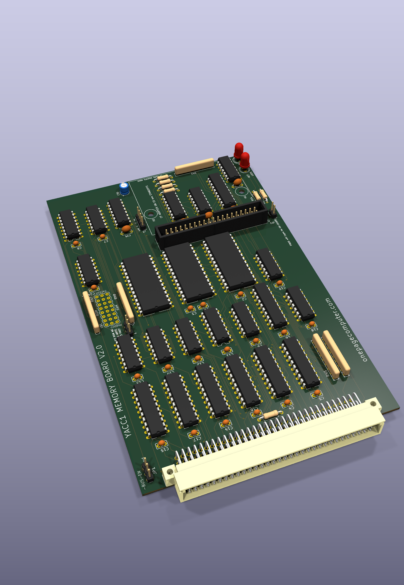
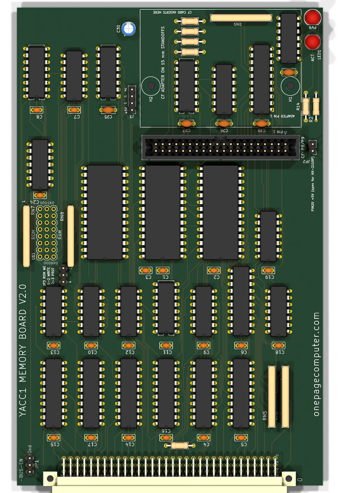
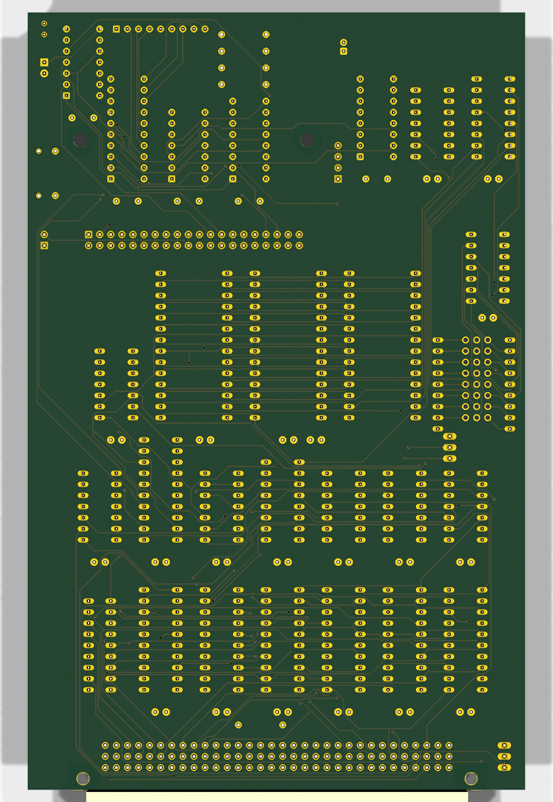

# Memory card v2.0 — theory of operation

The memory card v1.3 plus the CompactFlash disk interface, on one card. **Finished for fabrication 2026-09-25; ordered
from JLCPCB 2026-10-09, order 2000765A-Y52; not yet received or built.**

The memory circuit is v1.3's, unchanged except for JP3 (the ROM write-protect jumper) and R15 (the ADDR15
pull-down): its theory is the [v1 page](memory.md). The CompactFlash circuit is the CF card v1.0's: its theory is the
[CompactFlash page](cf.md). This page is what v2.0 adds to both: why the card was laid out again, the board, and the
parts that changed.

Sources: `hardware/cards/memory/kicad/v2.0/README.md` (the design notes, the board numbers, the open items),
`hardware/FABRICATED.md`, [the v1 page](memory.md) and [the CompactFlash page](cf.md).

## 1. What v2.0 is

The CompactFlash interface on this card:
`hardware/cards/memory/kicad/v2.0/` = the built v1.3 card plus the CF card v1.0 circuit ([`cf.md`](cf.md)), I/O-mapped
on ports P8/P9 as the ROM and the emulators use them; it would be the first use of the IO-ADDR0..3, -IO-RD and -IO-WR
pins this card leaves unwired today. The schematic is done and proven, but the card has less room than the earlier save
suggested: the built card routes the TMP high byte (DATA8-15) as a bundle of tracks across the lower right of the
board, and with its copper kept no placement of the five CF chips was found (the best packing fits four). So the whole card
is laid out again (decided 2026-09-24) with the CF section designed in: same circuit, outline, bus connector and
4-layer GND/VCC planes, new placement and copper. A first finished board (the IDE header J2 at the top edge, a TAODAN
adapter standing on it) was superseded the same day by the **standoff decision**: the CF-to-IDE adapter (an HX-2118P,
60 x 44 mm, no pin 20) mounts flat **on two 15 mm M3 standoffs on this card**, fed from J2 (parallel to the bus
connector) by a short straight 40-wire ribbon; five placements were trial-routed and **option E was chosen
(2026-09-25)**: the TMP registers and address buffers beside the bus connector, the glue column, the memory column
with the **ROM IC13 in its top row, uncovered and removable** (a keep-clear zone around it), J2, and the adapter over
the CF chips at the free top edge (its CF slot at that edge), the block decode IC7 / IC4 and the port decode IC30 in
the JP1 corner beside the U$1 jumpers. The board `memory-v2.0.kicad_pcb` is routed (0 unrouted, 69 through vias,
12.8 m of 0.25 mm track; DRC 0 copper violations, 0 unconnected; planes one piece each; netlist proof MATCH), its
silkscreen shows where the adapter goes, and its gerbers, NPTH/PTH drill, renders, placement PDF, BOM (with the
standoffs, screws and ribbon), JLCPCB order note and a 1:1 print are in that folder. The card cage slot in front of the
memory card stays empty (decided 2026-09-25), so the ~35-44 mm stack needs no other clearance. **Decoupling on v2.0:** one
100 nF per IC (C1-C19 and C24 for the built card's 20 ICs, as built; C25-C29 for the five CF chips) and C30 (10 uF
bulk at the adapter power header J3). The built card's C20-C23, four 100 nF with no IC beside them (v1.3 has them in
the cap row between C19 and C24, plain VCC-GND caps), were **removed from v2.0 (2026-09-24)**. **JP3, the ROM write-protect
jumper** (M2, 2026-09-29), was added beside the ROM, and **R15, the 470 Ω ADDR15 pull-down** (M1,
2026-09-30, [section 4.1 of the v1 page](memory.md)) beside the bus connector: 72 parts. Open before ordering (its README): the ribbon plug's pin 20 (open, or pull J2's pin 20). The adapter's power-pad
order was resolved 2026-09-26: a floppy pinout in J3's order, so the J3 cable is straight through (a hand-made harness).

## 2. The board

The v2.0 board as KiCad renders it, populated (`hardware/cards/memory/kicad/v2.0/memory-v2.0.kicad_pcb`, rendered
2026-10-27 by `tools/render_populated.py`, which gives each Eagle-converted part KiCad's standard 3D model in a copy of
the board: plain chips without markings; the U$1 3x8 jumper block has no model), with the CF section and the adapter's
standoff outline at the right (the adapter itself is not drawn):

