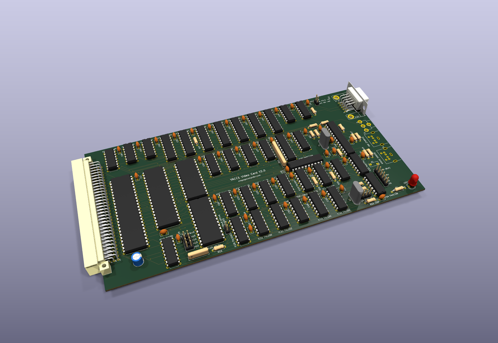
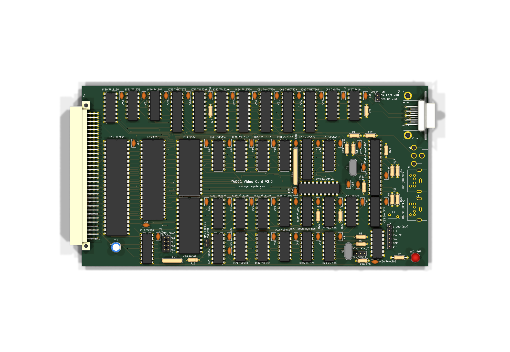
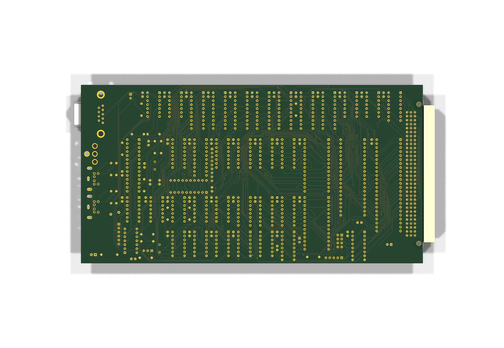

# Video card V2.0 — theory of operation

The video card's second generation: the v1.3 card plus a graphics layer, every register on I/O ports and two PS/2
ports. **Designed 2026-10-22, re-reviewed 2026-10-23, ready to order; not ordered or built.**

The text circuit (the 6845, the IDT7134 text RAM, the character pipeline, the DOTS jumper) is the v1 cards': its
theory is the [V1 page](video.md). This page is what V2.0 adds and changes. It was section 7a of the V1 page until
2026-10-24.

Sources: `hardware/cards/video/kicad/v2.0/README.md` (the design notes, the board, ordering), `BACKLOG.md` "Video card
V2.0", the two design reviews linked below, `embedded/video-ps2/README.md`, and [the V1 page](video.md).

## 1. The card

The V2.0 board as KiCad renders it, populated (`hardware/cards/video/kicad/v2.0/video-v2.0.kicad_pcb`, rendered
2026-10-24 by `tools/render_populated.py`: plain chips without markings; the two Mini-DIN PS/2 sockets and the RCA jack
have no 3D model and show as their pads):

The design master since 2026-10-22 (`hardware/cards/video/kicad/v2.0`, generated with its schematic from
`v20_netlist.py` by `gen_v20.py` and `build.sh`; design note in `BACKLOG.md` "Video card V2.0"). It is the v1.3 card -
6845, IDT7134 text RAM, the DOTS jumper and IC28's load-on-carry divider, 12 MHz, both fonts in one character generator
(on V2.0 an AT28C64B-15, `firmware/video/chargen-v20.bin`) - with three additions, on a 4-layer board (In1 GND plane, In2
VCC plane) 218 mm long (the sequencer logic V2.1l's length; X1 where every card has it). Revised the same day after its
design review: the review's fixes, **direct mode** and the **text-only build** (below); re-reviewed 2026-10-23 and
revised again the same day (every re-review finding applied, below): ready to order.

**Memory and ports.** The card keeps the $D000 block (IC18 74S85 + SV3): text RAM at $D000-$D7FF as before, and the
**graphics window at $D800-$DFFF** (2K, one scan-line plane). Every register is on an I/O port: IC30 (74LS138, enabled by
IO-ADDR3) decodes PA..PF (Y2..Y7), and two 74LS32 (IC31, IC32) OR each select with -IO-RD / -IO-WR, as the CF card does.

| Port | IN | OUT |
|---|---|---|
| PA | - | 6845 address register |
| PB | 6845 data (R14-R17) | 6845 data |
| PC | status (IC34 74LS244): bit 0 DOTS (1 = 6 dots), 1 VSYNC, 2 DE, 3 **TEXT-ONLY** (1 = no graphics chips), bits 7..4 = 0101 (**card ID $5x**) | control (IC33 74HCT273, cleared by -RESET): bits 0-2 PLANE, 3 CPAGE, 4 DPAGE, 5 TEXT-OFF, 6 GFX-ON (0 = direct mode), 7 XOR |
| PD | PS/2 status (IC52): bit 0 FULL, 1 SRC (0 keyboard, 1 mouse), 2 BUSY | PS/2 command (IC51 latch) |
| PE | PS/2 data (IC50 latch; reading clears FULL) | - |
| PF | spare | spare |

The 6845: -CS = PSEL_A AND PSEL_B (IC1/A: settled from the I/O address before the strobe), RS = IO-ADDR0, R/-W = -IO-WR,
**E = -IO-RD XOR -IO-WR** (IC26/C), high for the whole of every I/O strobe - the bench fix of 2026-10-21 (E from the
strobe, no one-shot) on I/O strobes. The JP1 latch IC2, the upper-half decode and R13/R14 are gone. A ROM before V2.0
finds the card ($D000 probe) but writes its 6845 table into graphics RAM ($D800/$D802) and reads `$D801` from it: no
picture until a ROM with the V2.0 driver (IN PC, (v AND $F0) = $50).

**The graphics layer** (8-dot mode only). IC39, a 62256: 32K = two 16K pages. The display reads page DPAGE at
**RA2..0:MA10..0** (eight 2K planes, plane n = scan line n of every cell): 512 x 192 at 64 columns, 8 dots a byte, bit 7
leftmost; the CPU window reads/writes page CPAGE, plane PLANE, offset ADDR10..0. The RAM is time-shared per character
slot on IC28's **QC** (CRTCCLOCK) while GFX-ON = 1: the counter runs 8..15 (8-dot) or 10..15 (6-dot), QC = 0 for 8..11
(10..11) = the CPU half, 1 for 12..15 = the display half (333 ns each at 12 MHz in 8-dot mode). Four 74LS157s (IC35-IC38)
pick the address on **NMUX = NAND(QC OR RCO, GFX-ON)** (IC32/C, IC19/D; 1 = the CPU on their I1 inputs): QC OR RCO holds
the display address until RCO has fallen, the edge the display latch IC42 takes its byte on (review V2-4), and GFX-ON = 0
holds the CPU address for good (direct mode, below).

| count | 8 | 9 | 10 | 11 | 12 | 13 | 14 | 15 |
|---|---|---|---|---|---|---|---|---|
| address | CPU | CPU | CPU | CPU | display | display | display | display |
| -WE when a write is pending | | low | low | | | | | |
| loads | WRQ (IC44) samples GWR | | | | IC41 (CPU read latch) on QC's rise | | | IC42 (display latch) on CHARCLOCK's rise |

- **Read** (slot mode): IC41 (74HCT374) loads the RAM byte at the CPU's address on every QC rise and drives DATA0..7
  while the window is read (-OE = NAND(GSEL, MEMRD, GFX-ON), IC48/C). The read strobe is a whole microcode step (2 us at
  1 MHz), so a complete CPU half always falls inside it. Slot-mode reads and writes need a CPU clock of at most ~1.8 MHz
  (review V2-24).
- **Write** (slot mode): WRQ = GWR (window AND -MEM-WR, IC47) sampled on CHARCLOCK's rise; WSLOT = WRQ AND NMUX AND
  GRDOE (IC1/B, IC54/A) turns the RAM's -OE off; **-WE = NAND(WRQ, NMUX, QA XOR QB, GWR)** (IC45/A, IC26/D; QA XOR QB
  through IC32/D, ORed with NOT GFX-ON): counts 9-10 (167 ns; count 10 only, 83 ns, in 6-dot mode). The write buffer
  IC40 (74HCT244, DATA -> GD) is enabled by -WE itself (V2-5), so it never meets the RAM's outputs on GD. A write never
  starts mid-slot and ends with the strobe; a 2 us strobe writes the byte two or three times.
- **Direct mode** (GFX-ON = 0, the reset state): the CPU owns the RAM. NMUX = 1 holds the CPU address; GFX-ON = 0
  presets WRQ (IC44's -PRE) and forces the phase term high, so **-WE = NOT GWR**; the RAM's -OE is the window read
  (GRDOE); reads reach DATA through **IC55**, a 74HCT244 GD -> DATA enabled by NAND(GSEL, MEMRD, NOT GFX-ON) (IC45/B),
  instead of the latch; RN3 (10k x 8) holds GD up between accesses. The window is then a plain SRAM. The microcode sets
  the address and the data a step before every `-MEM-WR` and holds them a step after (all 59 strobes), and its shortest
  read window is one step, so direct mode works at 1 MHz and at 6 MHz (6 MHz: 38 ns of read margin on a register
  selected in the step, 85 °C, with the register cards' HC244s; -WE 255 ns against tWP 45): `tests/video/v20_timing.py`.
  A register **counted** at the window's edge (the HC193 carry ripple) has ~0 to -104 ns at 6 MHz; only the code fetch,
  the pops (RET, IRET, POPR) and BRVR's second vector byte do that in one step, so the rules are: no code in the
  window at any clock, and at 6 MHz no stack and no BRVR vector table in it (re-review R2-5; the test fails if a window
  the rules permit has a negative margin). The layer is not displayed in this mode
  (GDG needs GFX-ON), so a program draws with the layer hidden at full speed and shows it with GFX-ON = 1. OUT PC
  switches at the end of its strobe; the rule is that the instruction writing PC does not access the window (no OUT
  record does; code is never run from the window).
- **Display**: IC42 latches the byte on CHARCLOCK's rise (with IC23's character code), IC43 (74LS166) loads it on the
  next CHARCLOCK (with IC24) and shifts it out bit 7 first: text and graphics dots stay in step.
- **Combine**: TDG = text dot AND NOT TEXT-OFF (IC1/C, IC46/D); GDG = graphics dot AND GFX-ON AND NOT DOTS (IC1/D,
  IC47/A, IC46/E: never in 6-dot mode, and the driver never sets GFX-ON there: R2-4); dot = (TDG OR GDG) AND NOT(TDG AND GDG AND XOR) (IC32/B, IC48/A); the video
  NAND3 (IC48/B) gates it with the delayed DE into IC27/A as before.

**The text-only build.** The graphics chips (IC35-IC45, IC55, RN3 and their capacitors) may be left off; two 1k
resistors fitted only then, R25 on GDOT and R26 on WRQ, hold the two nets those chips drive into fitted logic low
(`v20_netlist.text_only_check()` proves there are no others), and **IN PC bit 3** reads 1: IC44's second flip-flop, held
cleared, drives it low when IC44 is fitted, R27 pulls it high when not. Software reads bit 3 at reset and leaves GFX-ON
at 0 on a text-only card. It is the recommended first build (hardware/cards/video/kicad/v2.0/README.md).

**PS/2.** Two Mini-DIN-6 jacks (J2 keyboard, J3 mouse: Same Sky MD-60SM; 1 data, 3 GND, 4 +5 V through the 0.5 A PTC F1,
5 clock; R17-R20 4.7k pull-ups) on an ATmega328P (IC49, 16 MHz, firmware `embedded/video-ps2`). The ATmega never sits on the bus: it loads IC50 (data, IN PE)
from its local bus MD0..7 with LDDATA, which also sets FULL (IC53); the CPU's read clears FULL. OUT PD loads IC51 and
sets BUSY; the ATmega reads IC51 onto MD with -RDCMD, which clears BUSY. IC52 puts FULL, SRC, BUSY on IN PD. INTREQ AND
FULL (IC54/B: released the moment the CPU reads PE, and while the ATmega is in reset) drives the bus -INT (C13) through
IC27/D (open collector) and **jumper JP3 INT-EN** (off: the card never touches -INT). The FTDI header J4 programs and
debugs the ATmega (DTR auto-reset); the bus -RESET resets it through two open-collector inverters (IC27/E, F), so the
bus line only pulls MRST low. BUSY is on PB3 and SRC on PB5, the bootloader's LED pin (review V2-1). Commands and
the keyboard's codes: `embedded/video-ps2/README.md`.

**Jumpers.** SV3 (the block, 5-6 for $D000), SV4 (1-2: the 12 MHz crystal), JP2 DOTS (fitted: 8 dots, 64 x 24 with
graphics; open: 6 dots, 80 x 24), JP3 INT-EN.

**Design review** (2026-10-22, before ordering): [`hardware/DESIGN-REVIEW-video-v2.0.md`](../../hardware/DESIGN-REVIEW-video-v2.0.md) -
3 HIGH (the bootloader driving BUSY, the Mini-DIN footprint, the firmware's host-to-device bit count), 9 MED, 11 LOW, 6
INFO. All HIGH and MED fixes are in the design and the firmware (the status of every finding is at the top of the
review); a re-review of the changed slot logic, direct mode and the text-only build comes before ordering.
**Re-review** (2026-10-23): [`hardware/DESIGN-REVIEW-video-v2.0-r2.md`](../../hardware/DESIGN-REVIEW-video-v2.0-r2.md) - HIGH 0, MED 1, LOW 9, INFO 6; order after R2-1 (the MD-60SM side-leg slots, 0.8 mm -> 1.2 mm). **Every finding applied 2026-10-23** (the status table at the top of the re-review): R2-1 the side-leg slots 1.2 x 2.6 mm, R2-2 IC55's socket clearance (and a socket-outline check over the whole board), R2-3 the bus -RESET buffered by IC54/C, R2-14 `verify`'s list (`560977b`); R2-7 the 6845's B grade and C16's 16 V, R2-8 the README, R2-9 the silkscreen (overlaps 40 -> 0), R2-5 the counted-register windows in the timing test, R2-10 the firmware's reply filter; R2-4, R2-11 and R2-5's rules are the driver's, R2-6, R2-12, R2-15, R2-16 bench measurements. **Ready to order**; what to upload: the card's README, "Ordering".

**Software to follow**: the ROM's V2.0 driver (IN PC with bit 3, the 6845 through OUT PA/PB, drawing in direct mode),
the keyboard behind the console vectors, the emulators' V2.0 card model, Y1/OS `video`. `python3 tools/vidsim.py overlay
--card v2.0` draws the card's picture today; `vidsim.V20Card` models the CPU side (both modes, the text-only build).
