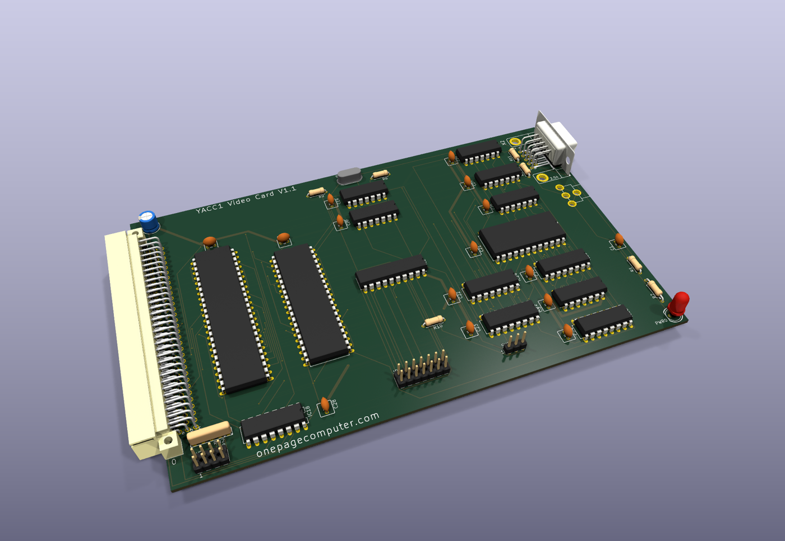
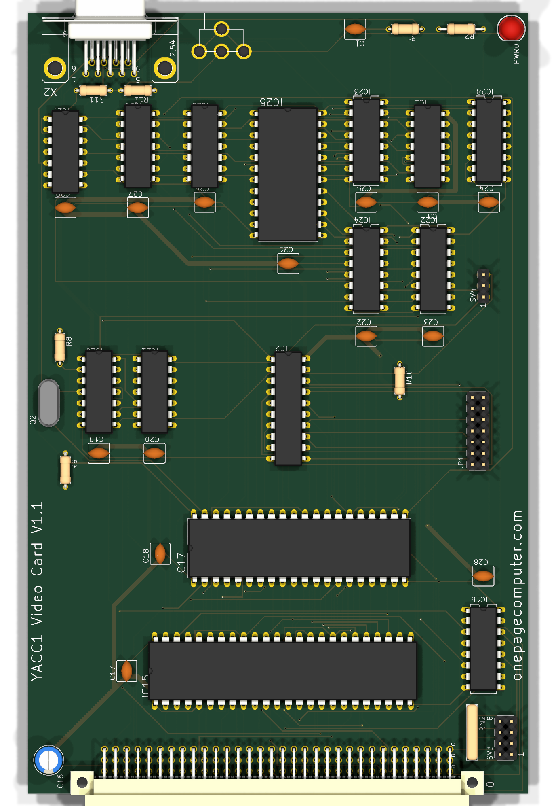
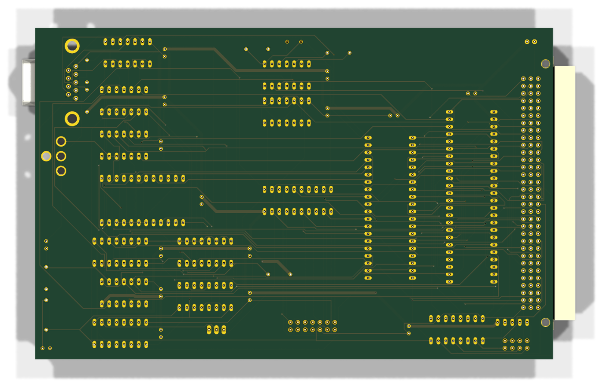

# Video card V1.0 / v1.1 — theory of operation

A memory-mapped alphanumeric display: an MC6845 CRTC reads a dual-port RAM that the CPU writes through the bus, a
character-generator EPROM and a shift register turn the characters into dots, and the result leaves the card as
separate video/HS/VS on a DB9 and as a sync signal on an RCA jack. Built once, in the machine for bring-up **without
the 6845 fitted**; the RAM half is proven, the CRTC half is not.

Written 2026-09-23 from the YACC1-D tree; section 8 (the ROM's driver, the `V` command, bring-up with it) added
2026-09-25; section 9 (the card at gate level in the microcode emulator) 2026-10-11.

Sources: `hardware/cards/video/eagle/v1.0-fusion-export-2026-09-18/Video_1.0.sch` and `.brd` (the built card, as
exported from Fusion 360; parts and nets parsed from the Eagle XML), `hardware/cards/video/kicad/v1.1/README.md` (the
design master since 2026-09-21), `hardware/cards/video/kicad/v1.0-fusion-export-2026-09-18/README.md` (the netlist
proof that found the rail fault), `hardware/cards/video/README.md`, `hardware/cards/video/docs/fix-6845-register-
select.md`, `hardware/DESIGN-REVIEW.md`, `hardware/DESIGN-REVIEW-NOTES-control-io.md` section 6, `docs/system/
MACHINE.md`, `docs/system/OS-PLAN.md` (decisions 2 and 4), `tests/video/README.md`, `tests/video/video_ram_test.py`,
`tests/video/hold_address.py`, `tests/memory/memory_full_test.py` and `full-run-2026-09-21.log`, `tools/alias_min.py`,
`BACKLOG.md`, `hardware/FABRICATED.md`.

## 1. Purpose and place in the machine

The memory card leaves the $D000 4K block undecoded (its block jumper is absent, `docs/cards/memory.md` section 3.2)
so that this card can answer there. A 4-bit comparator on the card matches ADDR12..15 against four jumpers, and
while the match holds and -VMA is asserted the card owns the bus cycle: with ADDR11 low it is the CPU-side port of
an IDT7134 dual-port RAM (2K reachable: A11 of the chip is grounded on that port), with ADDR11 high it is the 6845's
register interface (and, at odd addresses, a jumper read-back latch). The CRTC-side port of the same RAM is scanned
by the 6845's MA0..11 continuously, so the CPU never has to wait for the display and the display never sees the CPU.

The video generator is the textbook 6845 chain: a crystal dot clock, a counter that makes one character clock every
few dots, a 2732 character generator addressed by the character code and the CRTC's row address, a 74LS166
parallel-to-serial shift register, a cursor/attribute XOR, and display-enable gating, all through 7416 open-collector
drivers to the connectors.

```
    bus ADDR12..15 --> IC18 74S85 <-- SV3 jumpers (RN2 pull-ups)  --BOARDSEL--+
    -VMA --IC20/F--> IC18 A=B_in                                              |
                                                                              v
    ADDR0..10 ------> IC15 IDT7134 right port  <-- -CER = NAND(BOARDSEL, /ADDR11)   [IC19/B]
    DATA0..7  <-----> (A11R = GND, -OER = -MEM-RD, R/-WR = -MEM-WR)
                          | left port (read only, always enabled)
                          | VADDR0..11 <---- IC17 MC6845 MA0..11      IC17: -CS = NAND(BOARDSEL, ADDR11./ADDR0)
                          v VDATA0..5,7                                     RS = ADDR0, R/-W = -MEM-WR, E = one-shot
    IC23 74LS174 (char code, CHARCLOCK) --> IC25 2732 char gen <-- RA0..2 (IC17)
                                                | O3..O7
    IC22 74LS175 (cursor^attr, DE pipeline)     v
                                          IC24 74LS166 shift (DOTCLOCK, load on CHARCLOCK) --QH--> IC26/B XOR --> IC19/D NAND DE --> IC27/A --> DB9 pin 7 (R11 to the sync node)
    Q2 crystal + IC20 --> IC21 74LS90 /2 --> SV4 --DOTCLOCK--> IC28 74HC160 --QC--> CRTCCLOCK (IC17 CLK)
                                                                 \--NAND(QA,QC)--> CHARCLOCK (and IC28 -CLR)
    IC17 HS, VS --> IC27/C, /B (wired-OR, R12 to +5V, R11 to the video) --> RCA U$3 (composite);  HS --> DB9 pin 8, VS --> DB9 pin 9
    JP1 (2x7) --> IC2 74LS373 --> DATA0..7 at odd addresses with ADDR11 high
```

## 2. Bus signals used

| Signal | Bus pin | Dir | What it does on this card |
|---|---|---|---|
| ADDR0 | A3 | in | RAM A0R; the 6845's RS (as built); one term of the latch/CRTC select (through IC27/D, open collector) |
| ADDR1..10 | A4..A13 | in | RAM A1R..A10R (ADDR1 is also the pickup point for the RS fix) |
| ADDR11 | A14 | in | RAM half (0) or CRTC/latch half (1): IC19/B, IC1/B, IC1/D, IC20/E |
| ADDR12..15 | A15..A18 | in | IC18 comparator B inputs: the block select |
| DATA0..7 | A19..A26 | bidir | RAM right-port I/O, 6845 D0..7, IC2 latch outputs. No bus buffer |
| -MEM-RD | B23 | in | RAM -OER; one input of the E one-shot XOR (IC26/C) |
| -MEM-WR | B24 | in | RAM R/-WR; the 6845's R/-W; the other XOR input |
| -VMA | C12 | in | inverted by IC20/F into the comparator's A=B cascade input: no match without a valid address |
| -RESET | C30 | in | the 6845's -RES |
| VCC / GND | power pins | power | see the +5V rail note in section 4: as built, half the card's supply net had no connector pin |
| C3..C6 | | — | carry Blank V3.1's stale names (-ADDR-REG-RD0/LD0/RD1/LD1); connector only, unused |

DATA8..15, -BUS-EN, the strobes of the register/ALU/TMP world and the I/O lines are connector-only nets.

## 3. Schematic walkthrough, IC by IC

Chip types from `Video_1.0.brd`: IC1 74ALS08, IC2 74LS373, IC15 `VRAM` (deviceset `7134P`, IDT7134 4K x 8 dual-port,
DIL48), IC17 `6845` (DIL40, socket empty), IC18 74S85, IC19 74LS00, IC20 74LS04, IC21 74LS90, IC22 74LS175, IC23
74LS174, IC24 74LS166, IC25 `CHARGEN` (deviceset `2732`, DIL24), IC26 74LS86, IC27 7416, IC28 74HC160 (from the
`74xx-eu` library — the one HC part on a card of LS), Q2 crystal HC49U-V (value empty), R1 10K, R8/R9/R10 1K, R11 33,
R12 270, RN2 RNX4 (RN-5), C1 "1", C16 10.0 µF electrolytic, C3/C17-C29 0.1 µF, PWR LED with R2 330, U$3 RCA, X2 DB9
(`F09`), JP1 2x7, SV3 2x4, SV4 1x3.

### 3.1 Board select: IC18 (74S85), SV3, RN2, IC20/F

IC18 compares A (jumpers) with B (ADDR15..12: B3 = ADDR15, B0 = ADDR12). SV3 pins 1/3/5/7 go to A3/A2/A1/A0 (nets
N$51..N$48) with RN2 pulling them up to +5V; pins 2/4/6/8 are GND. A fitted jumper makes that bit 0. The cascade
inputs are A<B = GND, A>B = GND and A=B = N$89 = IC20/F(-VMA) = VMA, so A=B_out (BOARDSEL) is high only when the four
bits match *and* -VMA is asserted. For $D000 the pattern is 1101: A1 is the only 0, so the only jumper is SV3 5-6
(README; MACHINE.md's memory-card table reserves $D000 for it).

### 3.2 The RAM: IC15 (IDT7134) and IC19/B, IC20/E

Right (CPU) port: -CER = N$52 = IC19/B = NAND(BOARDSEL, N$87), N$87 = IC20/E(ADDR11) = /ADDR11 — selected for the
lower 2K of the block. -OER = -MEM-RD, R/-WR = -MEM-WR, A0R..A10R = ADDR0..10, A11R = GND (so the CPU reaches 2K of
the 4K chip, at $D000-$D7FF as the nets are named). Left (CRTC) port: -CEL and -OEL grounded, R/-WL tied to the +5V
net (read only), A0L..A11L = VADDR0..11 from the 6845's MA0..11, I/O0L..7L = VDATA0..7. The chip contains the
arbitration; nothing on the card sequences the two ports.

### 3.3 The CRTC interface: IC17 (MC6845), IC1, IC19/A, IC27/D, IC2, JP1

- **Select.** N$5 = IC27/D(ADDR0) = /A0 (open collector, **no pull-up**: it reads high only because it floats);
  N$2 = IC1/D = ADDR11 AND /A0; N$91 = IC19/A = NAND(BOARDSEL, N$2) = the 6845's -CS. So the chip is selected at even
  addresses in the upper half of the block.
- **Register select.** RS = ADDR0 directly. Since -CS needs A0 = 0 and RS = A0, the chip is only ever selected with
  RS = 0: **the data register cannot be reached as built.** This is the finding in `docs/fix-6845-register-select.md`;
  the fix moves IC17 pin 24 from ADDR0 to ADDR1 (section 5).
- **Read/write and E.** R/-W = -MEM-WR (low = write, the 6845 convention). E = CLK net = IC1/A = N$1 AND N$4. N$1 =
  IC26/C = -MEM-RD XOR -MEM-WR, high while exactly one strobe is active — for *every* memory cycle in the machine,
  BOARDSEL is not a term. N$3 = IC27/F(N$1) (open collector) through R1 10K to N$4 with C1 to GND: when a strobe starts
  the 7416 pulls N$3 low and C1 discharges through R1; E is the AND of the strobe and the not-yet-discharged C1 — an RC
  one-shot that bounds the E pulse even under single-stepping. When the strobe ends the 7416 releases, but the only
  charging path for C1 is IC1's input (there is no pull-up on N$3). Review finding 6.1 (section 4).
- **-RES** = -RESET (active low, correct). **LPSTB** floats (6.5). MA12/13, RA3/4 unconnected.
- **The read-back latch IC2 (74LS373).** Its eight D inputs are JP1 pins 1, 2, 4, 6, 8, 10, 12, 14; LE is JP1 pin 13;
  JP1 pin 3 is VCC, pin 5 GND. Its outputs sit on DATA0..7 and its -OC is N$16 = IC27/E(N$6), N$6 = IC1/C = N$17 AND
  ADDR0, N$17 = IC1/B = BOARDSEL AND ADDR11: the latch drives the bus at every **odd** address of the upper half, read
  or write (6.4). With JP1 open the inputs float and the latch reads as $FF — which is what `memory_full_test.py`'s
  phase F2 saw ("$D800-$DFFF ... reads 00 FF after writing 77 / 88").

### 3.4 Dot clock and character clock: Q2, IC20, IC21, SV4, IC28, IC19/C, R10

IC20/A and IC20/B with R8/R9 (1K) and Q2 form a Pierce oscillator; IC20/C buffers it onto N$57, which goes to SV4
pin 1 and to IC21's CKA. IC21 (74LS90, R0/R9 inputs grounded) divides by two on QA; IC20/D re-buffers QA onto N$59 =
SV4 pin 3. SV4 pin 2 is DOTCLOCK: the jumper picks the crystal or half of it. Q2's value is empty in the design
(**To verify:** read the crystal).

IC28 (74HC160) counts DOTCLOCK with A..D grounded and LD/ENT/ENP on N$73 (R10 to +5V, also the CLR of IC22/IC23/IC24).
CHARCLOCK = IC19/C = NAND(QA, QC), low only while the count is 5 (0101); it is IC28's own asynchronous -CLR, so the
counter divides by five and CHARCLOCK is a runt as wide as the clear propagation (6.2). QC is also CRTCCLOCK = the
6845's CLK. CHARCLOCK clocks IC22 and IC23 and is the SH/-LD of IC24.

### 3.5 Character pipeline: IC23, IC25, IC24, IC22, IC26/A, IC26/B, IC19/D

IC23 (74LS174) latches the character code VDATA0..5 on CHARCLOCK (D1 = VDATA5 ... D6 = VDATA0) and its Q6..Q1 drive
IC25's A3..A8; A0..A2 are the 6845's RA0..2 (row within the glyph); A9..A11 are grounded — a 64-character set, 8
rows, in the low 512 bytes of the 2732 (-CE and -OE grounded). O3..O7 go to IC24's D..H; O0..O2 are unused; IC24's
A, B, C, SER and INH are grounded. IC24 shifts on DOTCLOCK and loads when SH/-LD (CHARCLOCK) is low at a DOTCLOCK
edge; QH is the dot stream.

IC22 (74LS175) is a two-stage delay for the attribute and display-enable so they line up with the shifted glyph: D1 =
N$75 = IC26/A = CURSOR XOR VDATA7 (bit 7 of the character byte is an inverse-video attribute; VDATA6 is unused), Q1
to D2, Q2 to IC26/B; D3 = DE from the 6845, Q3 to D4, Q4 to IC19/D. IC26/B XORs the dot with the attribute; IC19/D
NANDs that with delayed DE; IC27/A (open collector) drives DB9 pin 7 (video) directly. (Corrected 2026-10-20 from the
netlist: R11 is not in series with the video; it joins pin 7 to the sync node, section 3.6.)

### 3.6 Sync outputs: IC27/B, IC27/C, R12, U$3, X2

HS goes to IC27/C and DB9 pin 8, VS to IC27/B and DB9 pin 9. The two 7416 outputs are wired-OR on one node (the
netlist's `Net-(IC27B-O)`: IC27 pins 4 and 6, R12, R11, the RCA jack U$3) with R12 (270 Ω) to +5V. **R11 (33 Ω) joins
that node to the video line** (IC27/A's output, DB9 pin 7). So the video has a pull-up, through R11 and R12 (about
300 Ω), and is pulled low during either sync, which blanks it; and the RCA jack carries video and sync combined (a
simple TTL composite), not sync alone (corrected 2026-10-20 from the netlist; this section said "a combined sync").
DB9 pin 1 is GND.
The `archive/eagle-projects/` LM1881 sync-separator project the README mentions is the related composite-video
experiment, not part of this card.

### 3.7 Power

The design has two 5 V nets. `VCC` reaches the bus pins A2/B2/C2/A31/B31/C31, R2, JP1 pin 3 and the *implicit* power
pins of IC17-IC28 (Eagle supplies those from the VCC symbol). `+5V` feeds IC1, IC2, IC15 pin 2 (R/-WL), RN2, R10,
R12, C16 and every decoupling capacitor — and reaches no connector pin. The KiCad netlist proof
(`kicad/v1.0-fusion-export-2026-09-18/README.md`: "MISMATCH (115/117 nets)", the two rails listed) found it on
2026-09-20; on the bench IC1, IC2 and the jumper pull-ups had been running on phantom power through input clamp
diodes, which is what produced the write-through fault below. The rails were joined with a wire on 2026-09-21; the
v1.1 master folds `+5V` into `VCC` with a joining track (proof 116/116).

## 4. Timing and the design-review findings

Two timing chains matter. The **bus side** is the memory card's: BOARDSEL needs IC20/F + IC18 (a 74S85, fast) and
IC19/B before -CER is valid, which happens within the address set-up step the microcode gives every memory access.
The **video side** runs on DOTCLOCK: IC24 must reload once per character and the 6845 must see an E pulse of at
least 450 ns (280 ns for the faster grades, per the review) for each register access. Neither has been measured: no
6845 has been fitted and no crystal value is in the tree.

| ID | Severity | Finding | Status 2026-09-23 |
|---|---|---|---|
| README, `fix-6845-register-select.md` | HIGH (functional) | RS = A0 while -CS requires A0 = 0: the 6845 data register is unreachable; the JP1 read-back latch occupies the odd addresses, so simply dropping /A0 from the select would make a bus fight. Fix: RS to A1 — a bent pin 24 wired to IC15 pin 41 (ADDR1) or bus A4 | **Open, bench job first** (BACKLOG); designed into `kicad/v1.1` as "still to do". After the fix: even addresses select the CRTC, A1 picks address (0) or data (1) register, odd addresses read the latch |
| 6.1 | HIGH (untested) | the E one-shot's capacitor C1 has no charging path except IC1's input current (no pull-up on IC27 pin 12); at run speed memory strobes arrive every few µs, N$4 sits below threshold, E is short, ragged or absent — the CRTC's registers cannot be written even after the RS fix | Open; goes with the 7416 pull-ups. Confirm without a 6845: run any loop, scope IC1 pin 2 (stuck below ~1.5 V) and pin 3 |
| 6.2 | MED | CHARCLOCK is a ~30-60 ns self-clear runt used as the 74LS166's load: the load only happens if the runt is still low at the next DOTCLOCK edge, i.e. for dot clocks above ~16-20 MHz; slower crystals give a blank display. A synchronous-clear counter (74HC162) holds the state for a full period | Open |
| 6.3 | MED | 74HC160 inputs (CLK, -CLR) driven by 74LS outputs: LS VOH 2.7 V min against HC VIH 3.15 V — works on typical parts, not by specification. 74HCT160 or pull-ups | Open |
| 6.4 | LOW | IC2's enable has no -MEM-RD term: a *write* to an odd upper-half address turns the latch onto the bus against the writer. Software must never write there | Open; noted for the fix document |
| 6.5 | LOW | LPSTB floating (NMOS input): tie low | Open |
| README | MED | 7416 outputs (IC27) drive IC1, IC2, IC26 with no pull-ups; /A0 (N$5) only reads high because it floats | **Resolved on the bench 2026-10-21**: 4.7k from IC2 pin 1 to pin 20 (N$16) and from IC27 pin 8 to pin 14 (N$5); N$3 has the 10k of 6.1, the video and sync outputs R11/R12. Still a v1.1 change |
| README | HIGH | +5V rail unfed (section 3.7) | **Resolved on the bench 2026-09-21** (wire), fixed in the v1.1 design |
| README | HIGH | write-through fault of 2026-09-18: a write to block 0 or 9 landed in the video RAM regardless of BOARDSEL | **Resolved 2026-09-21**: cause was the unpowered rail; `tests/video/video_ram_test.py` 8/8, `tools/alias_min.py` clean |
| DESIGN-REVIEW.md (mechanical) | MED | open-collector nets N$5 (IC27 p8) and N$16 (IC27 p10) without pull-up | Same as the 7416 item: resolved on the bench 2026-10-21. Without the N$16 pull-up the latch drove the bus on **every** memory read in the machine (2026-10-20/21, CPU out: ROM and RAM read 3F/7F/07; with a 74LS374 wrongly fitted as IC2, its power-up bytes E1/E9/E5). Bisected by pulling chips: clean with IC2 out, broken with it in, clean again with the pull-up |
| README / FABRICATED.md | LOW | inherits Blank V3.1's pre-V3.2 names on C3-C6 | Harmless (unused pins); start the next card from Blank V3.2 |
| Naming (this document) | doc | the README, the fix document and the reviews quoted the CRTC at `$D400`/`$D402` | **Resolved 2026-09-25: video RAM is $D000-$D7FF (2K), the 6845/latch half $D800-$DFFF** - the netlist reading; the fix document and README are corrected; the ROM (2026-09-25) already uses $D800/$D802. `video_ram_test.py` tests $D000-$D3FF only; the monitor's `VF`/`VD` check covers all 2K |

The memory-side conventions (floating LS inputs read high while the sequencer is off the bus; no pull-ups on the
backplane) apply here as on every card; this card adds the open-collector nets to the list of lines that depend on
it.

## 5. Jumpers, headers, connectors — and how the card is set

| Item | Pins / meaning | Setting in the machine (`docs/system/MACHINE.md`, README) |
|---|---|---|
| SV3 (2x4) | pairs 1-2 (A3), 3-4 (A2), 5-6 (A1), 7-8 (A0); fitted = 0, open = 1 (RN2 pull-up); compared with ADDR15..12 | only 5-6 fitted: block $D000 |
| RN2 | the SV3 pull-ups | 10k as designed (was 1k from the 2026-09-18 tests until 2026-09-21) |
| SV4 (1x3) | 1 = crystal, 2 = DOTCLOCK, 3 = crystal/2 | **To verify:** position |
| JP1 (2x7) | eight latch inputs (pins 1, 2, 4, 6, 8, 10, 12, 14), LE on 13, VCC on 3, GND on 5: a byte the CPU can read back at odd upper-half addresses (a configuration/ID byte; the README does not say what it was for) | **To verify:** whether anything is jumpered; F2's $FF says nothing is |
| IC17 socket | MC6845 | fitted 2026-10-21 (RS on A1, LPSTB to GND); `crtc_regs.py` ALL PASS. C1 measured 1 uF: E lasts ~12 ms on a slow strobe |
| X2 DB9 female | 7 video (R11), 8 HS, 9 VS, 1 GND | — |
| U$3 RCA | combined HS+VS (wired-OR, R12) | — |
| C16 10 µF, C17-C29 0.1 µF | bulk and per-IC decoupling — all on the former `+5V` net | — |
| Rail wire | +5V to VCC, added 2026-09-21 | fitted |
| Pull-ups | 4.7k IC2 pin 1 - pin 20 (N$16), 4.7k IC27 pin 8 - pin 14 (N$5), 10k IC27 pin 12 - pin 14 (N$3, 6.1) | fitted (the 4.7ks 2026-10-21) |
| IC2 | 74LS373 | a 74LS374 was in the socket until 2026-10-21 (pin 11 is a clock there, not LE) |
| Pins | two bent pins straightened 2026-09-18 | — |
| X1 | DIN 41612, Blank V3.1 names on C3-C6 | slot not recorded |

## 6. Bring-up and test

The plan from here, with the bus-tester scripts, the CPU test programs and the picture emulator:
[`docs/procedures/VIDEO-BRINGUP.md`](../procedures/VIDEO-BRINGUP.md) (2026-10-10).

What was done, in order (`tests/video/README.md`, README, MACHINE.md):

1. 2026-09-18: card installed, two bent pins straightened, RN2 changed to 1k while chasing a fault; the bus-tester
   RAM test showed the **write-through fault** — writes to $0010/$9010 (block 0 or 9, A0 = 0, A11 = 0) also landed in
   $D010. `tools/alias_min.py` is the 20-line reproduction.
2. 2026-09-20: the KiCad conversion's netlist proof reported the two 5 V nets; 2026-09-21 they were joined with a wire.
3. 2026-09-21: `tests/video/video_ram_test.py` **8/8 PASS**, quick and full (1K, patterns, inverse, neighbour
   isolation, the four write-through checks, read stability with memory traffic in between — necessary because
   $D000 is undecoded on the memory card and a floating bus can fake a good read); RN2 restored to 10k, quick test
   8/8 again; `tests/memory/memory_full_test.py` phases E1-E5 and F2 PASS in the 14/14 run.
4. Not done: anything with a CRTC. `hold_address.py HEX [--rd]` exists for the RS-fix verification table in the fix
   document (park an address, meter IC17 pins 24/25).

If it misbehaves:

| Symptom | Check |
|---|---|
| RAM reads back what was written even at an address nothing should answer | the memory card's $D000 block echoes the bus; use `video_ram_test.py`'s ordering (other traffic between write and read) |
| writes elsewhere land in the video RAM | the +5V/VCC wire (IC1 pin 14, RN2 pin 1 must be at 5 V); BOARDSEL at IC18 pin 6 must be low for non-$Dxxx addresses |
| RAM answers at the wrong block | SV3 against ADDR15..12; RN2 pull-ups |
| (with a 6845) registers cannot be written | E (IC1 pin 3) per 6.1; -CS per the RS finding (CRTC at $D800/$D802) |
| no picture | DOTCLOCK at SV4 pin 2; CHARCLOCK width at IC19 pin 8 against IC28 pin 2 (6.2); glyph bits on IC24 pin 13; DE and HS/VS from the 6845 |

## 7. Revision history and what the next revision changes

| Rev | Date | Status | Notes |
|---|---|---|---|
| V1.0 | designed in Fusion 360, export 2026-09-18 | **built, in the machine** without CRTC | drawn on Blank V3.1; the board file was exported under the template's name and stored as `Video_1.0.brd`; no fab files in the tree (`hardware/FABRICATED.md`: "none in tree") |
| v1.1 | KiCad master since 2026-09-21 | design only | `+5V` folded into `VCC` with a joining track (proof 116/116, DRC clean). To do before ordering: RS from A0 to A1, pull-ups on the 7416 outputs (BACKLOG) |

The v1.1 board as KiCad renders it, populated (`hardware/cards/video/kicad/v1.1/video-v1.1.kicad_pcb`, rendered
2026-10-11 by `tools/render_populated.py`, which gives each Eagle-converted part KiCad's standard 3D model in a copy of
the board: plain chips without markings; the RCA jack has no model and shows as its pads):

[](images/video-v1.1-render-angled.png "Open full size")

[](images/video-v1.1-render-top.png "Open full size")

[](images/video-v1.1-render-bottom.png "Open full size")

Beyond v1.1, `docs/system/OS-PLAN.md` decision 2 changes the architecture: **video card v2 puts the 6845 registers on
I/O ports** — PA = address register, PB = data register, with RS = IO-ADDR0 and no latch — so the card needs only its
2K of display RAM in the memory map and the whole -CS/RS/E problem of the memory-mapped interface goes away
(the E pulse becomes a function of -IO-RD/-IO-WR on those two ports). The memory map then has two jumper-only
variants (decision 4): A, video stays at $D000 (nothing to change on the cards today); B, video moved to $E000 with
the memory card's $D000 jumper set to RAM for a 36K TPA. Phase 4 of the plan pairs the card with a PS/2 keyboard
controller behind the console vectors. The review items 6.2/6.3/6.5 (character clock, HC levels, LPSTB) and the
crystal/C1 values belong in that redesign whichever interface it keeps.

## 8. Software: the ROM's driver and bring-up with the `V` command (2026-09-25)

`ROM 2026-09-25` (`firmware/rom/shipped`, **not burned yet**) drives this card; the full description is
[`docs/programming/MONITOR.md`](../programming/MONITOR.md) section 11, the addresses are in
[`firmware/abi/README.md`](../../firmware/abi/README.md). In short:

- **Detection**: at reset the ROM writes $55 and $AA to $D000 and reads each back (the old byte restored); both must
  come back. A floating bus reads the `LDA`'s own operand byte ($00) instead, so an absent card is not mistaken for
  one. The result is `VIDPRES` ($0FF0) and the banner line `VIDEO CARD FOUND`.
- **No auto-start**: `VIDAUTO EQU 0` in `monitor.asm`, so reset never touches the CRTC or the screen. Set it to 1 and
  rebuild once the card works: reset then programs the CRTC, clears and turns mirroring on.
- **Mirroring**: while `VIDMIR` ($0FF1) is set, CHAROUT/UARTOUT (the console of the monitor, BASIC, Y1/OS and every
  program) also write each byte at the screen's cursor: CR, LF, BS, TAB, FF, wrap and scroll handled in software.
- **Geometry assumed**: 80 x 24 from $D000 (1,920 of the 2K), one byte a character, the driver storing ASCII with
  lower case moved up (right for a 2513-style set: glyph = ASCII bits 0-5); CRTC table for a 10 MHz dot clock,
  5 dots a character, 8 lines a row (15.7 kHz, 60 Hz). The crystal and the EPROM contents are not in the tree:
  equates and one 16-byte table in `monitor.asm` change them.
- **Y1/OS**: `video [on|off|clear|init|probe]` (`/BIN/VIDEO`, `os/man/video`).
- **Emulators**: `-V` prints the screen, `-W` logs CRTC writes, `-N` removes the card; `tests/video/emu.py`.

**Bring-up on the machine, in order** (the 6845 not fitted yet; the monitor's `V?` lists the commands):

| Step | Type | Expect / what it shows |
|---|---|---|
| 1 | (reset) | `VIDEO CARD FOUND` under the banner; missing = the $55/$AA probe failed: `E D000` by hand, then this document's section 6 |
| 2 | `VS` | `VIDEO 01  MIRROR 00  CRTC 00  ROW 00  COL 00` |
| 3 | `VF55`, `VD` | 24 rows of `U` (the RAM as text over the serial line); `VFAA`, `VD`: `*` everywhere. Any other character = a stuck or crossed data bit in the upper 1K too ($D400-$D7FF was never tested by `video_ram_test.py`) |
| 4 | `VC`, `VW0000 HELLO`, `VW1700 LAST ROW`, `VD` | the text in rows 00 and 17; `B D000` shows the bytes ($48 $45 ...) |
| 5 | `VM1`, then any command, `VD`, `VM0` | the console's own output in the screen RAM, scrolled at the bottom |
| 6 | (6845 fitted, RS moved to A1, E fixed) `VR0E 12`, then `VR0E` | `12` read back from R14 (the cursor high byte, readable on every 6845; R12/R13 are write-only on Motorola's MC6845): the register interface works. `00`/`FF` = -CS, RS or E (section 4) |
| 7 | `VI` | the CRTC programmed from the ROM's table (`VR rr` reads back R12-R17 only); `VS` shows `CRTC 01`. Then a monitor on the DB9: sync first (`VR00 7E`, `VR02 62`, `VR04 1F`, `VR07 1C` to move it), then the text of step 4 |
| 8 | `VM1` | from here the console shows on the screen; the CRTC cursor follows (R14/R15) |
| 9 | (card debugged) | `VIDAUTO EQU 1`, rebuild the ROM, burn: the card starts at reset (`BACKLOG.md`) |

`VB aaaa bb ..` writes raw bytes anywhere in $D000-$DFFF (glyph codes, inverse video with bit 7, or the CRTC at
$D800/$D802); **never an odd address above $D800**: that is the JP1 latch, which drives the bus even on a write
(finding 6.4). The addresses are confirmed (2026-09-25): RAM $D000-$D7FF, 6845 $D800/$D802.

## 9. The gate-level model in the microcode emulator (2026-10-11)

`software/ucemu/y1ucemu -G v1.0` (also `--video-rev v1.0`; the debugger passes it with `python3 software/y1dbg
--video-rev v1.0`) replaces the behavioural card of `software/videomodel.h` with this card's bus path built from its
netlist, `hardware/cards/video/kicad/v1.0-fusion-export-2026-09-18/reports/netlist.net`, the way the ELF repository's
System-5 emulator builds its 6845 card. Without `-G` the emulator keeps the behavioural card, and its speed is
unchanged.

### 9.1 What is modelled

`software/gatemodel` (Python) reads the netlist, puts every pin the board connects differently from the schematic on
its board net (the "ONLY ON BOARD" groups of `reports/netlist-compare.txt`: IC1 pin 14 and IC2 pin 20 are on `+5V`;
the KiCad net names go back to the Eagle names this document uses), applies the jumper settings and the reworks as
netlist edits, and traces back from every control and address pin of the three bus devices:

| Part | On the bus path as |
|---|---|
| IC18 74S85 | the block compare: A = SV3 (RN2 pull-ups, SV3 5-6 fitted), B = ADDR12..15, cascade A=B = /-VMA (IC20/F): BOARDSEL |
| IC20 74LS04 | /-VMA (section F), /ADDR11 (section E) |
| IC1 74ALS08 | E = N$1 AND N$4 (A), BOARDSEL AND ADDR11 (B), AND ADDR0 (C: the latch), ADDR11 AND /A0 (D: the 6845) |
| IC19 74LS00 | -CS of the 6845 (A), -CER of the RAM (B) |
| IC27 7416 | /A0 (D), the latch's -OC (E), the one-shot's discharge (F) - open collector, no pull-ups |
| IC26 74LS86 | N$1 = -MEM-RD XOR -MEM-WR (C) |
| R1/C1 | the E one-shot: N$4 keeps the level it had before the strobe for the length of the access |
| IC15 IDT7134 | bus device: the right port (-CER, -OER = -MEM-RD, R/-WR = -MEM-WR, A0R..A10R = ADDR0..10, A11R grounded) |
| IC17 MC6845 | bus device: -CS, E, R/-W = -MEM-WR, RS; its register file stays behavioural (`videomodel.h`: R14-R17 read back, the rest read 0, the address register is write-only) |
| IC2 74LS373 | bus device: drives DATA0..7 while -OC is low, from its D inputs (JP1, all open: they float and read as 1) |

The trace refuses to build a card whose bus path reaches a part with no model, a bus data line or a device's own
output. IC21-IC25 and IC28 (dot clock, character clock, character pipeline, character generator) are checked to be
off it and are not simulated: the picture stays with `tools/vidsim.py`, as before. Since no data line feeds the
decode, the decode is a pure function of ten bus inputs (ADDR0, ADDR1, ADDR11, ADDR12..15, -VMA, -MEM-RD, -MEM-WR):
the gates are evaluated once for each of the 1024 combinations, in three-valued logic (0, 1, X; a floating TTL input
reads 1, a floating NMOS or CMOS input X; a chip on a rail with no source drives nothing), and written into
`software/ucemu/videogate.h`. Each microcode step looks its decode up, so the card is evaluated every step, with or
without a strobe.

### 9.2 Revisions and reworks

The reworks are data in `software/gatemodel/video.py`, each with the document it comes from; `y1ucemu -G list`
prints them.

| Edit | What | Source |
|---|---|---|
| jumper SV3 5-6 | the block $D000 | section 3.1, the card's README |
| short `+5V` to `VCC` | the rail wire of 2026-09-21 | section 3.7, `hardware/cards/video/README.md` |
| lift IC17 pin 24, wire it to IC15 pin 41 | RS from ADDR0 to ADDR1 | `hardware/cards/video/docs/fix-6845-register-select.md` |
| lift IC1 pin 13, wire it to VCC | the fix that document warns against (/A0 tied high) | the same, "Don't do that" |

| `-G` | The card |
|---|---|
| `v1.0` | as fitted: the rail wire, a 6845 with RS on A1 - what the ROM's driver and `videomodel.h` assume |
| `v1.0-no6845` | as in the machine today: the rail wire, the 6845 socket empty |
| `v1.0-no-rs` | `v1.0` without the RS fix: a 6845 fitted as drawn |
| `v1.0-no-5v` | `v1.0-no6845` without the rail wire: the card on the bench on 2026-09-18 |
| `v1.0-drawn` | neither rework, a 6845 fitted |
| `v1.0-a0fix` | the rail wire and the wrong fix |

### 9.3 What it shows

- **The card as fitted behaves as the behavioural model.** `tests/video/gate.py` runs the monitor's video unit (VS,
  VC, VW, VB, VF, VD, VR, VI, VM1), Y1/OS's `video` command and the bring-up programs (`vram`, `crtcreg`, `testcard`,
  `vstress`, `estrobe`) with both cards: the console output, the screen, the CRTC registers, the step counts and the
  disk are identical, and there are no bus events, except `crtcreg`'s two deliberate reads of the JP1 latch, which
  report its floating inputs.
- **Without the RS fix the data register is unreachable**, as section 4 and the fix document say: `VR0E 12` writes
  $12 into the address register, `VR0E` reads $FF (nothing drives the bus: the address register is write-only), R14
  is never written, and `crtcreg` prints `BAD` for R14, R15 and the repeat. With the socket empty (`v1.0-no6845`)
  `crtcreg` prints the same; only the events tell the two apart ("socket empty" against "read with RS = 0").
- **Without the rail wire the write-through fault comes back**: with IC1, IC2 and RN2 on a rail with no source, the
  three open SV3 inputs follow it, IC18's compare is undefined in every block with ADDR13 = 0 (0, 1, 4, 5, 8, 9, C,
  D), and so is -CER at ADDR11 = 0. A write to $9010 lands in the display RAM at $D010. The bench saw blocks 0 and 9
  (and not block 1, the control in `tools/alias_min.py`): which way an undefined select falls is analog; the model
  takes it as selected and reports it.
- **The wrong fix is a bus fight**: a read of $D801 has the 6845's data register and the latch on DATA0..7 together.
- **The latch drives on -VMA alone** (finding 6.4 is wider than writes): its -OC has no strobe term, so in every step
  whose address bus shows an odd address in $D800-$DFFF, IC2 drives DATA0..7, read or write or neither. The
  microcode asserts -VMA in every step, so any step with such an address in the selected register while another
  source drives the data bus is a fight; `-G` reports it as contention. None of the programs `tests/video/gate.py`
  runs does it.

### 9.4 What is not modelled

Timing: the E pulse is taken as long enough for every access and C1 as recharged between accesses (finding 6.1 is
a timing question: the pulse width, and whether the input current alone recharges C1 at run speed); a strobe held
over several steps gives E in each of them. The display side (the 6845's counters, the character pipeline) is the
picture model's. V1.1's netlist is not wired in (it is not built); the instruction-level emulator keeps the
behavioural card.
